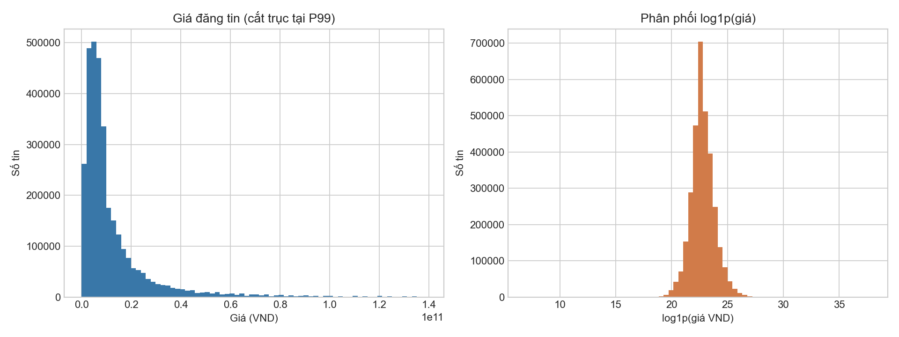
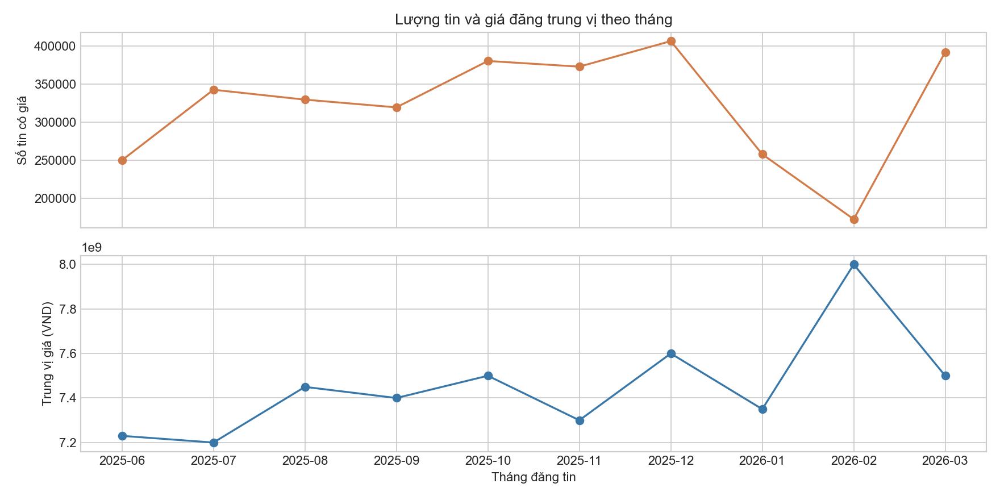
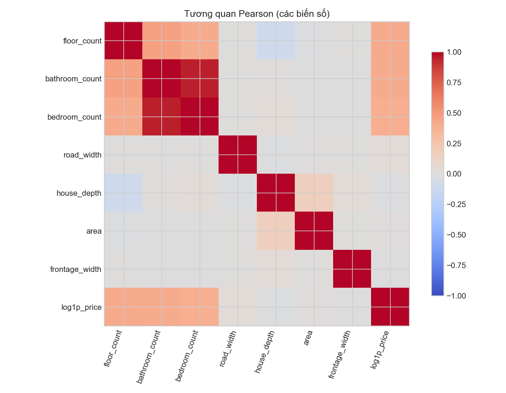

# Bước 1 — EDA: Tin đăng bất động sản Việt Nam

## Nguồn và phạm vi

- Dataset: [tinixai/vietnam-real-estates](https://huggingface.co/datasets/tinixai/vietnam-real-estates), giấy phép CC BY-NC 4.0.
- Đọc 10 shard Parquet hoàn chỉnh, tổng **3,500,744 dòng** (khoảng 100.0% số dòng dataset theo card); bỏ qua 0 tệp dở/nhân bản. Mỗi shard chỉ dùng một bản hoàn chỉnh. Trường thời gian là `published_at` (ngày đăng tin).
- Khoảng ngày theo chuỗi ISO: **2025-06-01T00:01:38.762000 → 2026-03-30T23:59:56.217000**; ngày thiếu: **0**, sai định dạng: **0**.
- Đây là **giá niêm yết trong tin đăng**, không phải giá giao dịch đã chốt. Kết quả chỉ phản ánh giá chào bán.
- Phân tích dùng các cột cấu trúc, địa lý, giá và thời gian; bỏ qua văn bản `name`/`description` ở vòng EDA này.

## Kiểu dữ liệu sau khi đọc

| Cột | Kiểu |
|---|---|
| `property_type_name` | `str` |
| `province_name` | `str` |
| `district_name` | `str` |
| `ward_name` | `str` |
| `price` | `float64` |
| `area` | `float64` |
| `floor_count` | `float64` |
| `frontage_width` | `float64` |
| `house_depth` | `float64` |
| `road_width` | `float64` |
| `bedroom_count` | `float64` |
| `bathroom_count` | `float64` |
| `house_direction` | `str` |
| `balcony_direction` | `str` |
| `published_at` | `string` |

## Chất lượng dữ liệu

- Giá thiếu/không hợp lệ: **218,494** thiếu; **57,320** không dương.
- Tin trùng hoàn toàn trên các cột đã nạp: **109** (không có mã tin duy nhất trong schema; đây là phép kiểm tra trên các cột EDA).
- Giá hợp lệ (price > 0): **3,224,930**; trung vị **7,500,000,000 VND**, trung bình **30,110,232,207 VND**, P1 **590,000,000**, P99 **139,000,000,000**, skewness **1733.34**.
- Ngoài hàng rào 1.5×IQR trên giá dương: **322,158**; chưa loại bỏ vì có thể là bất động sản thật ở phân khúc cao.

### Giá trị thiếu theo cột

| Cột | Số thiếu |
|---|---:|
| `house_depth` | 3,432,288 |
| `balcony_direction` | 2,933,342 |
| `road_width` | 2,830,873 |
| `floor_count` | 2,691,982 |
| `house_direction` | 2,414,214 |
| `frontage_width` | 1,726,424 |
| `bathroom_count` | 1,720,974 |
| `bedroom_count` | 1,600,361 |
| `ward_name` | 496,716 |
| `price` | 218,494 |
| `district_name` | 101,933 |
| `area` | 4 |
| `province_name` | 0 |
| `property_type_name` | 0 |
| `published_at` | 0 |

### Loại bất động sản phổ biến

| Loại | Số tin |
|---|---:|
| Nhà | 1,575,536 |
| Đất | 832,766 |
| Căn hộ chung cư | 762,800 |
| Biệt thự/Nhà liền kề | 269,782 |
| Shophouse | 59,860 |

## Lượng tin và giá đăng theo tháng

| Tháng | Số tin có giá dương | Giá trung vị (VND) |
|---|---:|---:|
| 2025-06 | 250,216 | 7,230,000,000 |
| 2025-07 | 342,660 | 7,200,000,000 |
| 2025-08 | 329,695 | 7,450,000,000 |
| 2025-09 | 319,542 | 7,400,000,000 |
| 2025-10 | 380,398 | 7,500,000,000 |
| 2025-11 | 372,957 | 7,300,000,000 |
| 2025-12 | 406,468 | 7,600,000,000 |
| 2026-01 | 258,064 | 7,350,000,000 |
| 2026-02 | 172,863 | 8,000,000,000 |
| 2026-03 | 392,067 | 7,500,000,000 |

Giá trung vị theo tháng dao động; lượng tin thay đổi đáng kể. Vì vậy cần dùng chia theo thời gian, và không diễn giải thay đổi trong tin đăng thành biến động giá giao dịch.

## Tương quan tuyến tính

| Biến số | Pearson r với log1p(giá) |
|---|---:|
| `floor_count` | 0.411 |
| `bathroom_count` | 0.399 |
| `bedroom_count` | 0.384 |
| `road_width` | 0.038 |
| `house_depth` | -0.015 |
| `area` | 0.014 |
| `frontage_width` | -0.001 |

Tương quan Pearson chỉ xét quan hệ tuyến tính trên các biến số; các cột địa lý/phân loại không được thể hiện trong bảng này.

## Biểu đồ

## Diễn giải và giới hạn

- Giá thường lệch phải; đối chiếu thêm `log1p(price)` trong mô hình và báo cáo lỗi cả trên thang log lẫn VND.
- Trung vị theo tháng mô tả giá chào bán của các tin được đăng trong tháng; không diễn giải thành chỉ số tăng/giảm giá giao dịch.
- Dataset card mô tả khoảng thời gian 06/2025–03/2026. Đây là khoảng ngắn, nên đánh giá theo thời gian chỉ đo khả năng dự đoán giai đoạn kế tiếp trong dữ liệu, không chứng minh độ bền qua chu kỳ dài.
- Trước mô hình hóa cần chốt phạm vi loại tài sản (ví dụ chỉ `Nhà`, hay gồm cả căn hộ/đất); giá đất và giá nhà không cùng một nhóm mục tiêu.
- Nếu chưa đủ toàn bộ shard, các thống kê bên trên chỉ mô tả phần dữ liệu đã tải, không đại diện chắc chắn cho toàn bộ dataset.
- Cần xác minh trong thực nghiệm các listing trùng/đăng lại và các giá được suy ra/chuẩn hóa từ nội dung tin.
