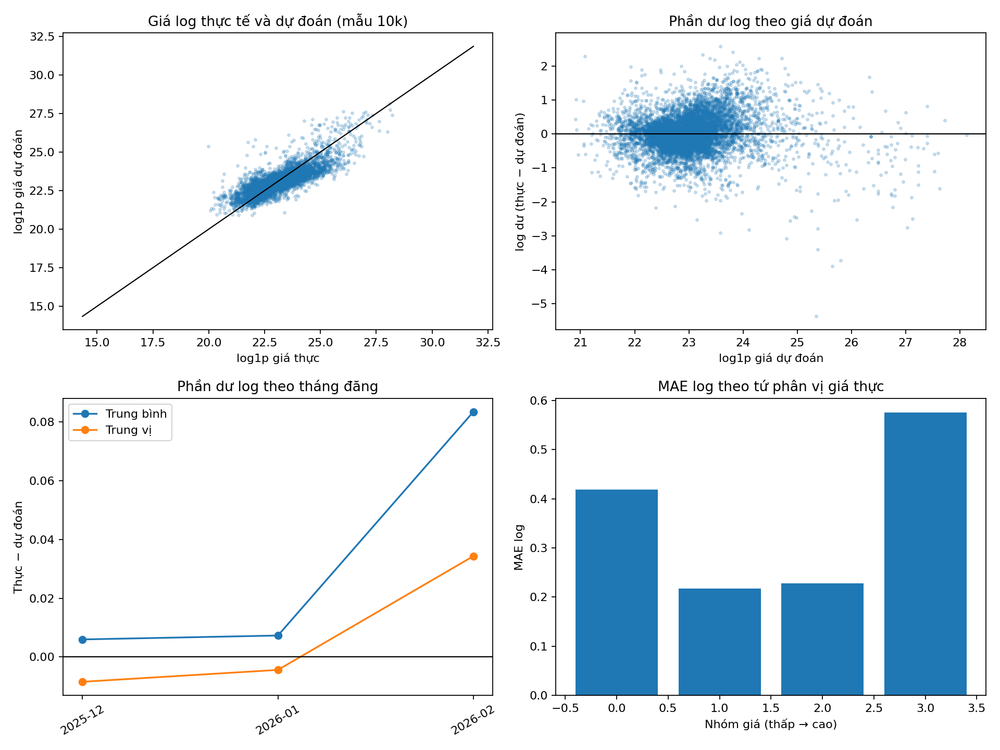

# Validation residuals — Lasso candidate

- Fit preprocessing/model on train only; validation is the later period 2025-12-17–2026-02-08. Test is not read.
- Metrics: RMSE VND **160,235,503,953**, MAE VND **8,715,084,461**, MAPE **47.22%**, R² VND **0.039**; RMSE log **0.509**, MAE log **0.360**, R² log **0.639**.
- FISTA stopped at 200 iterations; final relative change **0.00348**, convergence threshold 0.0001.
- Mean log residual (actual − predicted): **0.016**; correlation with actual log-price: **0.640**. Positive residual means underprediction.

## Residual by month

| Month | Tin | Mean log residual | Median log residual |
|---|---:|---:|---:|
| 2025-12 | 88,057 | 0.006 | -0.008 |
| 2026-01 | 111,363 | 0.007 | -0.004 |
| 2026-02 | 26,926 | 0.084 | 0.034 |

## Residual by actual price band

| Price band (VND) | Tin | MAE log | Mean log residual |
|---|---:|---:|---:|
| (1699999.999, 5900000000.0] | 57,537 | 0.419 | -0.346 |
| (5900000000.0, 8400000000.0] | 56,001 | 0.217 | -0.100 |
| (8400000000.0, 14700000000.0] | 56,317 | 0.228 | 0.056 |
| (14700000000.0, 67999000000000.0] | 56,491 | 0.576 | 0.460 |

Ridge/Lasso validation predictions are saved in `reports/validation_ridge_lasso_residuals.csv`. Price/month aggregates above describe Lasso. Its corresponding metrics are compared with Ridge below.

- Ridge validation: RMSE log **0.525**, MAE log **0.369**, MAPE **50.72%**, mean residual **-0.003**, corr(residual, actual log price) **0.711**.
- Lasso validation: RMSE log **0.509**, MAE log **0.360**, MAPE **47.22%**, mean residual **0.016**, corr(residual, actual log price) **0.640**.
